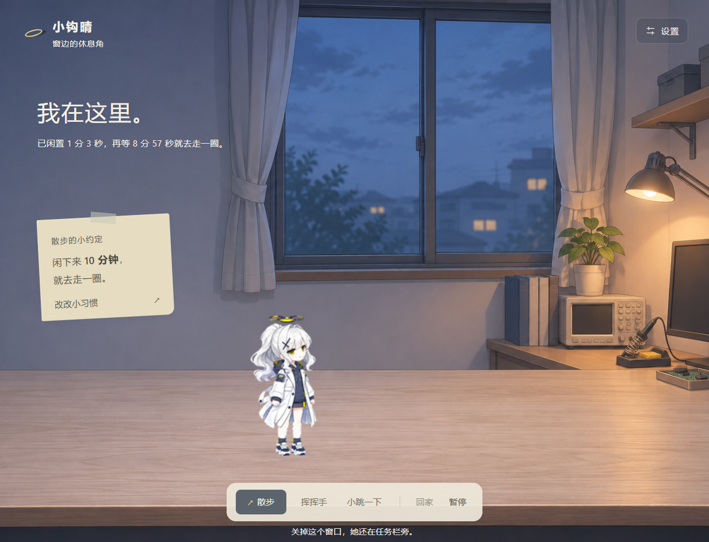
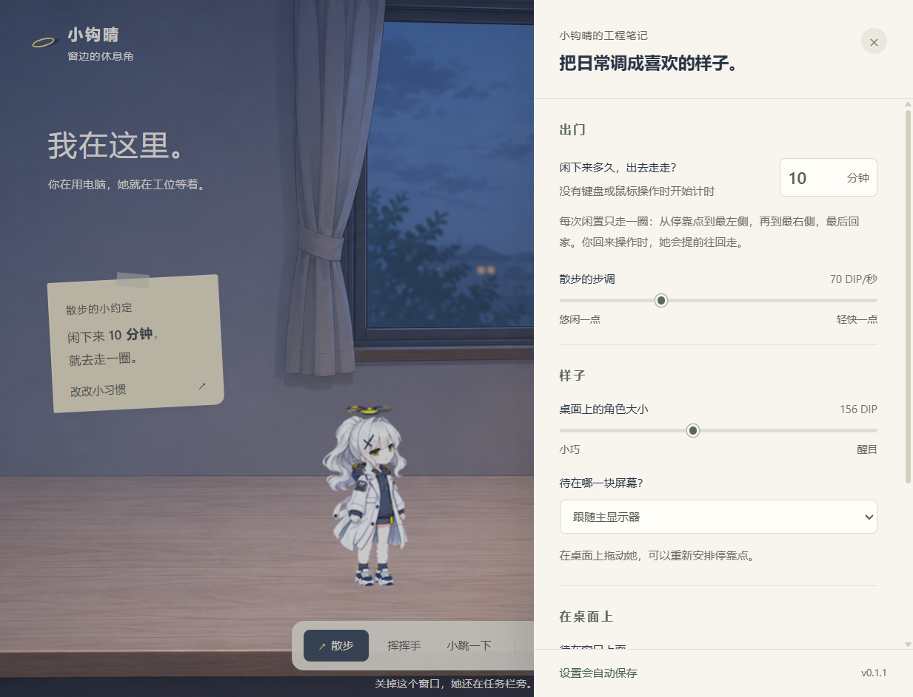

# 小钩晴 · Omagari Hare

一个独立运行的 Windows 桌宠。你操作电脑时，她在任务栏旁安静呼吸；默认连续 **10 分钟**没有键盘或鼠标操作后，沿任务栏上沿散步一圈，再回到停靠点。关闭 Codex 不影响她运行。



主页是一张安静的窗边工位：小钩晴站在桌面上，与你桌面上的角色共用原有动画图集。场景显示真实的待机、巡游、返程与暂停状态；常用动作留在桌沿下方，低频参数收进右侧设置抽屉。

## 开始陪伴

打包后可运行以下任意一种：

- **便携版**：`release/Omagari-Hare-0.1.1-x64-portable.exe`，直接双击。
- **安装版**：`release/Omagari-Hare-0.1.1-x64-nsis.exe`，安装后启动“小钩晴”；安装版可在设置中选择随 Windows 登录启动。

这些路径是本地构建输出，不代表已在 GitHub 发布可下载文件。首次启动会打开工位主页；之后可右键桌面角色或点击系统托盘图标再次打开。点击主页的设置按钮或工程便签都能展开设置抽屉。关闭主页窗口后桌宠仍在运行，从托盘选择“退出小钩晴”结束程序。

| 操作 | 效果 |
| --- | --- |
| 轻点角色 | 挥手 |
| 双击角色 | 小跳 |
| 拖动角色 | 沿当前屏幕下沿调整并保存停靠点 |
| 右键桌面角色 | 打开工位主页 |
| 主页散步按钮 | 立即体验一趟巡游 |
| 主页挥手／小跳按钮 | 在当前状态允许时触发对应角色动作 |
| 回到停靠点 | 提前返程 |
| 暂停陪伴／暂停散步 | 立即归位并停止自动出发 |
| 主页设置按钮／工程便签 | 打开同一个设置抽屉 |
| 点击穿透 | 角色不再接收鼠标点击；从托盘恢复或打开设置 |

默认路线从左侧出发，到最右侧后回到原地。拖动设置停靠点后，路线为 **停靠点 → 最左侧 → 最右侧 → 停靠点**。每次闲置只自动走一圈；你恢复输入时，她提前回家，下一次达到完整闲置时长后再出发。暂停后继续、解锁或从休眠恢复时，会等待新的输入再开始下一轮闲置计时。

安静待机时，靠近她脸部的鼠标会触发八个主要方向的注视，范围为距脸部参考点 20–220 DIP。它是离散姿势响应，不是连续转头动画。

工位里的动态角色是实际桌宠状态的预览，位置与朝向跟随巡游进度；挥手、小跳在主进程确认后播放。主页不生成虚构的聊天、情绪数值或工作记录。环境背景和角色分开绘制，角色继续使用原有 `hare-atlas.png`；全部在本地运行，无需在线服务。

## 可调设置



设置抽屉集中容纳闲置时间、大小、速度、显示器和系统开关；可通过关闭按钮或 Escape 收起，回到工位场景。工程便签与常规设置按钮提供相同入口，不需要记忆隐藏手势。

| 设置 | 默认值 | 范围或说明 |
| --- | --- | --- |
| 闲置时间 | 10 分钟 | 1–120 分钟 |
| 角色大小 | 156 DIP | 96–240 DIP，显示单元高度，包含透明留白 |
| 散步速度 | 70 DIP/秒 | 20–180 DIP/秒 |
| 陪伴的屏幕 | 主显示器 | 可选择当前连接的显示器 |
| 保持在最上层 | 开启 | 可关闭以让普通应用覆盖她 |
| 鼠标点击穿透 | 关闭 | 透明区域默认穿透；开启后整个桌宠穿透 |
| 登录时来陪你 | 关闭 | 仅安装版支持，便携版和开发模式手动启动 |

设置保存在 Electron `userData` 目录内的 `settings.json`，应用关闭后仍保留。闲置判断使用系统提供的无输入时长；不记录键盘内容、鼠标轨迹或屏幕画面。角色和动画资源均在本地，无需 Codex、账号或网络服务。

## 开发与构建

在 Windows x64 上安装 Node.js 22 或更新版本与 npm，然后在仓库根目录执行：

```powershell
npm ci
npm start
```

`npm ci` 按锁文件安装依赖，首次安装需要下载 Electron。开发模式同样独立启动桌宠；使用托盘退出后再重新启动，避免单实例保护把新的启动请求送给旧实例。

```powershell
npm test
npm run check
npm run test:integration
npm run test:ui
npm run test:layout
npm run dist
```

| 命令 | 用途 |
| --- | --- |
| `npm test` | Node 单元测试：巡游状态机、几何边界和设置处理 |
| `npm run check` | JavaScript 语法及动画图集规格检查 |
| `npm run test:integration` | Playwright 启动 Electron，检查窗口、渲染、设置及行为；临时资料和产物放在忽略提交的 `test-results/` |
| `npm run test:ui` | 检查工位主页、设置抽屉及相关界面交互；实际通过情况见验证记录 |
| `npm run test:layout` | 检查多种窗口比例、200% 缩放、角色脚底站位、内容碰撞和抽屉滚动 |
| `npm run test:packaged` | 构建后检查 `release/win-unpacked/` 内真实 EXE 的场景、动画与巡游 |
| `npm run screenshots` | 用隔离资料目录与默认 10 分钟设置刷新文档首页及抽屉截图 |
| `npm run pack` | 生成 `release/win-unpacked/` 开发检查包 |
| `npm run dist` | 生成 x64 便携版和 NSIS 安装程序 |

集成测试通过替换系统闲置读数缩短等待，并使用临时设置目录；它不等同于真实等待十分钟，也不能代替多显示器、不同缩放比例、锁屏和任务栏布局的人工检查。本次验证结果见 [验证记录](docs/verification.md)。

当前开发分支：`feat/standalone-desktop-pet`。提交代码、锁文件、资源和文档；`node_modules/`、`release/`、临时测试资料等由 Git 忽略。

## 实现结构

- `src/main.cjs`：Electron 进程、透明窗口、托盘、系统闲置检测和屏幕事件。
- `src/core/`：与窗口解耦的巡游状态机、工作区几何和设置约束。
- `src/renderer/`：精灵绘制、点按与拖动、工位主页及中文设置抽屉。
- `assets/animations.json`：每帧时长与图集坐标，含 `feetY=201` 的固定脚底基线。
- `assets/hare-workbench.png`：单独生成的无人物窗边工位背景，动态角色在其上独立绘制。
- `docs/character-design.md`：完整形象、色彩、动作语义和行为设计。
- `docs/design-review.md`：Gemini 4 Neon Medium 与 Claude Opus 5.5 Medium 的实际设计评审记录和采用说明。

闲置与锁屏事件使用 Electron [`powerMonitor`](https://www.electronjs.org/docs/latest/api/power-monitor)，显示器工作区及鼠标位置使用 [`screen`](https://www.electronjs.org/docs/latest/api/screen)，透明、不抢键盘焦点的角色窗口由 [`BrowserWindow`](https://www.electronjs.org/docs/latest/api/browser-window) 承载。

场景主页与参数抽屉的设计依据见 [设计复核](docs/design-review.md)；这份记录是设计输入，不代表外部模型替项目做了实现或测试。现有九类动作可查看 [动作预览](assets/motion-preview.gif)，背景生成提示词见 [工位背景记录](docs/prompts/workbench.md)。

## 已知边界

- 当前构建目标为 **Windows x64**，可执行文件**未签名**。没有声明 macOS、Linux 或 ARM64 支持。
- 底部任务栏时沿任务栏上缘活动；任务栏自动隐藏或位于顶部／侧面时，沿当前显示器工作区下沿活动，不沿竖向任务栏行走。
- 尚未实现检测全屏应用后自动隐藏。可在设置中关闭置顶，或通过托盘暂停、退出。
- 当前左右移动素材呈轻快小跑；“散步”指巡游行为，新绘慢走、转身过渡及更多日常动作属于后续扩展。
- 多屏与 DPI 变化采用系统工作区重新约束位置，具体硬件组合仍需实际验证。
- 分数缩放下为原生窗口留出最多 1 DIP 的贴边余量，避免窗口取整覆盖任务栏。

## 图像与许可

小钩晴是《蔚蓝档案》的角色，本项目是非官方同人桌宠。软件代码使用 [MIT 许可证](LICENSE)；该许可证不自动覆盖原角色、标识或图像。资产来源、完整性哈希与权利说明见 [assets/README.md](assets/README.md)。
