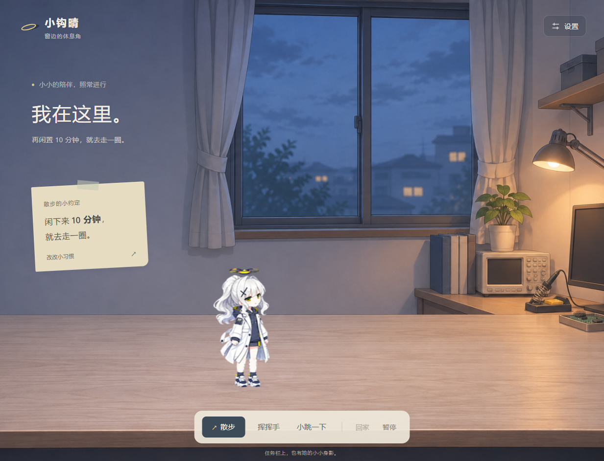
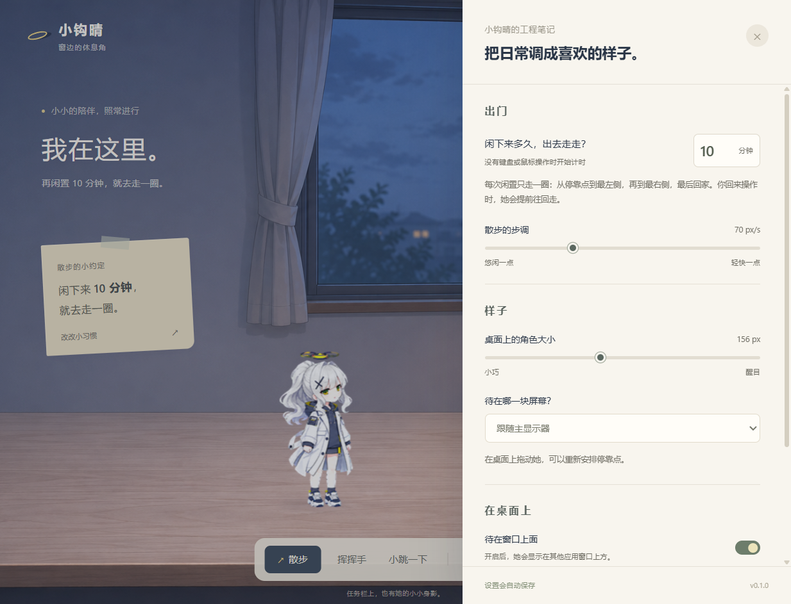

# 小钩晴 · 桌面伙伴设计

小钩晴是一位安静、略带困意的工程师伙伴。她在你操作电脑时留在桌面边缘；当键盘和鼠标安静下来，再沿任务栏上沿散步一圈。形象、动作与设置共同围绕“有存在感、容易找到、不过度打断”设计。

本文记录角色基准和首版已实现的行为。测试方法及运行方式见仓库 README；这里的验收要点是检查清单，不代表所有真实硬件场景均已验证。标为“后续”的内容没有计入首版交付。

## 形象基准

保持既有的日系赛璐璐 Q 版比例、细线条和清晰轮廓。她有银白高马尾、两侧柔软卷发、金绿色眼睛，以及固定在一侧刘海上的黑色 X 发卡。头顶保留黑黄三环光环，身体穿白色实验外套、藏蓝卫衣和深色短下装，脚穿深色运动鞋。外套下摆与马尾提供运动时的次级摆动；不可把这些识别点随机换侧、增删或缩放。

日常神情微困、放松，眼睛半睁，嘴型小而克制。迎接时轻轻挥手，思考时低头关注掌心；不使用夸张大笑、频繁惊跳或持续大幅摇摆。白衣、银发在浅色桌面上仍应由深色轮廓线保持可读性；透明背景不增加装饰性底板。

母版用于核对身份，实际运行使用逐格统一的精灵图。源单元尺寸为 192 × 208 像素，默认显示单元高度为 **156 DIP**，宽度随比例缩放；设置允许 96–240 DIP。这里的高度包含透明留白，实际人物略小。完整保留光环、发梢和鞋子，不能单独放大头、裁掉光环或压扁身体。

## 工位主页与设置抽屉

主界面由一张完整的窗边工位承载：蓝灰色夜窗、淡木色桌面、右侧暖光台灯和少量工程用品构成日常空间。角色继续使用原有透明图集，在环境上独立绘制，不把角色烘焙到背景中。桌面留出大块可落脚区域，使她的待机和移动有明确的位置。

主页保留三层信息：角色与环境、真实状态、桌沿下方的常用动作。散步、挥手、小跳直接可见，回家和暂停也使用明确按钮；没有把任意桌面点击或拖动到角落设计成隐蔽命令。闲置分钟数、大小、速度、显示器及系统开关集中到右侧设置抽屉，主页设置按钮与工程便签都能打开它。

抽屉采用原生 `dialog`，提供关闭按钮、Escape 关闭和关闭后的焦点恢复。便签为场景增加生活感，常规设置按钮保证入口容易找到；两者功能一致，不让用户猜测哪个才是真正的设置入口。

该方向来自 [实际设计复核记录](design-review.md)。Gemini 4 Neon Medium 提出单场景、低频参数抽屉和克制动效；Claude Opus 5.5 Medium 建议用角色环境、真实状态和桌沿动作形成三层关系，并让工程便签兼作入口。这些是已收到的设计意见；是否通过使用与测试仍以程序和验证记录为准。

### 配色

| 色彩 | 建议值 | 用途 |
| --- | --- | --- |
| 纸白 | `#F6F7FB` | 设置抽屉、清爽留白 |
| 藏蓝 | `#243149` | 主文字、主要控件、角色服装呼应 |
| 浅银 | `#CFD5E2` | 分隔线、次要轮廓 |
| 信号黄 | `#F2D641` | 小范围状态点、强调细节 |
| 柔绿 | `#90A94C` | 启用状态、眼睛色彩呼应 |

场景以蓝灰、米白和淡木色为主，台灯提供局部暖光；控件沿用纸白与藏蓝，黄色只作为少量点缀。文字明确表达状态，例如“安静待机”“正在散步”“散步已暂停”；颜色不承担唯一的信息表达。标题与控制使用真实文字和控件，背景图中没有文字、按钮或标识。

### 真实状态与动作反馈

主页预览取自实际桌宠的巡游状态、方向、位置和设置，随巡游进度映射到桌面上的位置。挥手、小跳要在当前状态允许且主进程确认后播放；暂停只说明停止出发，不用缺少对应动作的趴睡或打哈欠文案。闲置信息使用系统读数，不添加虚构的出发时间承诺、聊天、情绪数值或工作记录。

现有角色图集保持不变，新背景为 `assets/hare-workbench.png`，生成来源见 [工位背景记录](prompts/workbench.md)。图片、动画与交互在本地运行；无需为场景接入在线服务。

## 动作字典

| 表现 | 资源键 | 节奏与使用意图 |
| --- | --- | --- |
| 安静呼吸 | `idle` | 6 帧、6.6 秒一圈；肩膀、衣袖和发梢小幅运动 |
| 向右散步 | `running-right` | 8 帧、1.06 秒一圈；用于向右巡游 |
| 向左散步 | `running-left` | 8 帧、1.06 秒一圈；用于返程 |
| 轻轻招手 | `waving` | 4 帧、0.7 秒一圈；手保持抬起，手腕轻摆 |
| 小跳 | `jumping` | 5 帧、0.84 秒；起跳、腾空、落回原地 |
| 困倦低头 | `failed` | 8 帧、1.22 秒；保留素材，独立桌宠不赋予任务失败含义 |
| 等待 | `waiting` | 6 帧、1.01 秒；双手在胸前，安静等待 |
| 掌心思考 | `running` | 6 帧、0.82 秒；资源历史名保留，实际不是跑步 |
| 检查与思索 | `review` | 6 帧、1.03 秒；保留供动作预览与后续交互 |
| 视线方向 | `look` | 素材有 16 个离散方向；首版使用其中八个主要方向回应近处鼠标 |

现有横移动作是轻快小跑的步态，“散步”描述的是沿任务栏巡视的行为。首版复用这些成熟动作；专门的慢走步态与转身过渡属于后续新绘内容。

播放使用每帧时长，不能把每一帧统一为固定帧率，否则会改变停顿和循环接缝。方向切换使用独立左右图像，不镜像；地面固定在单元内 y=201，跳跃和跑步的腾空保留在图像里。

## 首版桌宠行为规格

### 独立运行

桌宠作为 Windows 应用运行，关闭 Codex 后仍可继续陪伴。角色通过透明窗口显示在桌面上，不占用普通任务栏按钮，系统托盘可打开工位主页。主页的设置按钮和工程便签打开设置抽屉。动画、设置和闲置判断均在本地完成，运行时无需登录角色服务。

### 闲置与巡游

默认阈值是 **10 分钟**，可调整为 1–120 分钟。这里的闲置指操作系统报告的键盘和鼠标无输入时长，不能仅依据桌宠窗口有没有收到事件。应用不需要采集输入内容，也不保存按键或鼠标轨迹。

一个闲置周期内只自动巡游一趟，完整路线为 **停靠点 → 最左侧 → 最右侧 → 停靠点**。首次停靠在可用范围左侧，所以直接向右出发，再返回左侧；拖动更改停靠点后，先走到最左侧，再经过最右侧，最后回家。左右边界留有安全余量。默认速度为 70 DIP/秒，可调整为 20–180 DIP/秒；手动“现在去散步”便于体验，不需要等待十分钟。

用户恢复输入时结束巡游路线，提前走回停靠点。恢复输入会开启新的闲置计时；只有又达到完整阈值才允许下一次自动巡游。暂停会立即归位，继续陪伴后等待新的输入再重新计算下一次巡游。锁屏或系统休眠时隐藏桌宠；解锁或恢复后回家，并等待新的输入，不补播离开期间积压的巡游。

任务栏上沿由屏幕工作区确定。底部任务栏时，脚底贴着工作区下边缘；自动隐藏任务栏或任务栏不在底部时，可沿工作区下边缘活动。不同 DPI 与多显示器场景使用系统坐标和所选显示器工作区，行进范围不能跨进不可见区域。屏幕配置变化后重新约束位置，避免宠物留在已断开的显示器上。

### 交互与控制原则

设置抽屉提供闲置时间、大小、速度、显示器、置顶、点击穿透和登录启动；主页与托盘均可开始巡游、回到停靠点或暂停。主页另有挥手、小跳操作。退出入口位于托盘。退出结束桌宠进程；收起抽屉返回场景，关闭主页窗口仍保留桌宠。登录启动默认关闭，仅安装版可由用户开启，便携版及开发模式不注册。

桌面角色交互采用轻量反馈：轻点挥手、双击小跳、拖动沿当前屏幕下沿调整停靠点、右键打开工位主页。拖动结束后保存停靠位置并恢复待机。透明区域使用图像透明度判断点击穿透；手动开启全局点击穿透后，通过托盘进入主页和设置。

安静待机时，鼠标距离脸部参考点大于 20 DIP 且小于 220 DIP，会选择八个主要方向之一短暂注视。巡游、拖动、点按动作、暂停和全局点击穿透期间不启用注视。它是离散姿势的方向响应，不是连续转头动画。

## 现有资产与后续扩展

首版已有完整透明图集、九类动作、十六方向视线，以及经过对齐的慢呼吸、挥手与思考循环。独立应用支持闲置后自动往返、可调整参数和本地运行；场景主页复用这些资产表现实际状态，低频参数移入抽屉。动作预览不代表每个资源都已有自动触发条件。

后续可以新增真正的慢走和停步转身、不同方向的坐姿、短暂伸懒腰，以及工作区边缘的小憩动作。语音、对话、任务提醒、音频互动与在线服务都不属于本次默认行为，也不应为了展示角色而引入。

视线素材的四个中间方向差异较细，157.5° 到 180° 之间存在约 9.5px 的中心变化。首版只采用八个主要方向，避免使用这些细微中间姿势；更平滑的切换迟滞、连续转头和全方向重绘留待后续，不把十六张视线图直接循环播放。

## 架构依据与当前边界

主进程通过 [`powerMonitor.getSystemIdleTime()`](https://www.electronjs.org/docs/latest/api/power-monitor) 获取系统闲置秒数，并响应锁屏、解锁和休眠恢复事件。巡游状态机依据这份输入决定何时出发、返程和等待下一轮。

显示器选择、工作区边界和鼠标位置使用 Electron [`screen`](https://www.electronjs.org/docs/latest/api/screen)。透明角色由 [`BrowserWindow`](https://www.electronjs.org/docs/latest/api/browser-window) 承载，窗口不获取键盘焦点，并通过鼠标事件穿透和置顶选项控制桌面交互。

当前目标是 Windows x64，构建产物未签名。底部任务栏时沿任务栏上缘活动；自动隐藏、顶部或侧面任务栏时沿显示器工作区下沿活动，不沿任务栏竖边行走。没有实现检测全屏应用后自动隐藏；需要时可关闭置顶、暂停或从托盘退出。多屏和 DPI 的几何边界由程序处理，仍需在具体硬件与任务栏配置上实际检查。

## 验收要点

1. 独立启动后能显示完整透明角色，关闭 Codex 不影响桌宠进程。
2. 默认十分钟不操作后开始一趟左右往返，返回出发位置；持续闲置不反复出发。
3. 键盘或鼠标恢复输入能提前结束巡游并返程，新闲置周期重新计时。
4. 左右移动面朝行进方向，脚底与任务栏上沿一致，光环和发梢不被裁切。
5. 修改阈值、大小与速度能持久保存；设置与托盘能停止巡游及退出。
6. 锁屏时隐藏、恢复后回家并等待新输入；缩放或显示器工作区变化后仍能找到宠物。
7. 工位预览的方向、巡游进度和动作与实际桌宠一致；散步、挥手、小跳、回家及暂停均有明确按钮。
8. 设置按钮和工程便签打开同一抽屉，Escape 可关闭，关闭后焦点恢复；主页与抽屉在窗口缩小时仍能操作。

角色来源和图像权利说明见 [资产说明](../assets/README.md)。软件代码的许可不自动覆盖原角色和图像。
